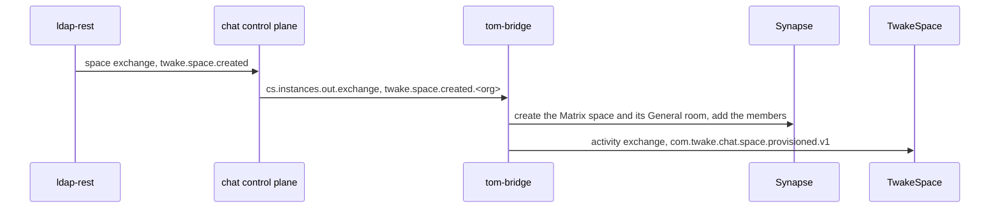

# Spaces

With a `spaces` block in its config, the bridge gives each TwakeSpace space a
Matrix space on the organization's homeserver, and keeps its members in line
with their roles in the directory.



## Events

ldap-rest publishes the space events of every organization on the `space`
exchange. In SaaS, the chat control plane forwards each one to its
organization's bridge with the organization id appended to the routing key, so
a bridge only receives its own. A single installation binds `twake.space.#` on
`space` directly.

* `created` - creates the Matrix space, adds TwakeSpace's app service user and
  the members, then publishes `com.twake.chat.space.provisioned.v1` with the
  room id on the activity exchange.
* `updated` - renames the Matrix space.
* `member.added`, `member.role.changed` - adds the member with the level of
  their role.
* `member.removed` - removes the member.
* `deleted` - removes every member at once. The Matrix space is deleted 30
  days later.
* `synced` - carries the whole space. The bridge handles it like `created`, and
  also renames the Matrix space and removes the members it no longer lists.
* `sync.completed` - lists the organization's spaces. The bridge removes the
  members of each Matrix space it provisioned before the sync whose space is no
  longer listed, and deletes it 30 days later, as for `deleted`.
* Group events are ignored: ldap-rest also publishes a member event for each
  user a group change affects.

ldap-rest publishes `synced` and `sync.completed` for every organization each
night, and on request
([linagora/ldap-rest@32f96d0](https://github.com/linagora/ldap-rest/blob/32f96d0f1314543f6d5bb913d1d6d8ac70bdc697/src/plugins/twake/spaces.ts)).

With `syncRequestExchange` set, the bridge requests a sync when it starts and
knows no space yet, which is the case at its first deployment. It publishes
`twake.space.sync.requested` on that exchange once subscribed, so the `synced`
events find its queue. The spaces created before chat was deployed then get
their Matrix space without waiting for the night.

## The Matrix space

* It is unencrypted, so the bridge and TwakeSpace can read it.
* Its alias is `#twake-space-<space id>`, lowercased since the directory
  ignores the case of space ids. The bridge finds the room again from
  the space id through it, so a redelivered `created` reuses the room and
  announces it again. The bridge's registration must reserve these aliases,
  or Synapse refuses to create the room with `M_EXCLUSIVE`:

  ```yaml
  namespaces:
    aliases:
      - exclusive: true
        regex: "#twake-space-.*:<domain>"
  ```

* The bridge bot is the only one at level 100, so membership and settings only
  change through the directory. The level of a member follows their role in
  the space:

  | Role in the space | Level | In the Matrix space and General |
  | --- | --- | --- |
  | admin | 75 | posts, and removes the messages of others |
  | editor | 50 | posts, joins a call, votes in a poll |
  | viewer | 0 | reads only: no message, reaction, vote or call |

  TwakeSpace's user is at 50.
* A member without a Matrix account gets one, named the way the SSO mapping
  names it (`localpartFrom`). For that person to sign in, the homeserver's OIDC
  provider needs `allow_existing_users: true`.

## General

Each Matrix space holds a General room, `#twake-space-<space id>-general`,
which the space's aliases rule above also covers.

* It is public: anyone on the organization's homeserver can join it, and the
  room directory does not list it.
* The bridge adds and removes the space's members, TwakeSpace's user included,
  in General as in the Matrix space, with the same levels.
* A sync only removes from General the members it removes from the Matrix
  space, so someone who joined General on their own stays.
* Deleting the space makes General invite only, so no one can join it again,
  then removes everyone from it. General is deleted with the Matrix space.
* Whoever is not a member of the space reads General but cannot post in it.
* A Matrix space created without General gets it at its next `synced`.

## Ordering

Any number of pods consume the space queue, each up to 4 events at once. The
events of different spaces run together. Those of one space run one at a time,
on every pod:

* Each event takes the lock of its space before it reads anything: a queue in
  the pod, then a Postgres advisory lock (`pg_advisory_lock`) shared by the
  pods of one database.
* A pod that stops closes its connection, which releases its locks. RabbitMQ
  then delivers its unacknowledged events to another pod.

The lock is there because the events of a space change the same rooms, and
Matrix writes the power levels of a room whole: of two changes made at once,
one is lost. It also keeps a `created` event from adding members while the
`deleted` event of the same space removes them.

The lock does not order the events. They can reach the bridge out of order,
through retries or because two pods took them together. The bridge stores the
timestamp of the last change it applied to each member and to the space name,
and ignores an older event. The lock makes that check and the change one step.

Without the database, only the queue in the pod is left and no timestamp is
stored: run a single pod, or two pods may change a space at once and an older
event may undo a newer one, until the nightly sync.

Each event holds one database connection for the time of its lock: 4 of the
10 connections of the pool at most, and the others serve the queries. An event
the database cannot lock fails and is retried, since without the lock it could
run beside the pod that holds it.

The space queue was declared with `x-single-active-consumer` by earlier
versions of this branch. RabbitMQ refuses to declare a queue again with other
arguments (`PRECONDITION_FAILED`), and the bridge then fails to start: delete
that queue once it is empty, and the bridge declares it again.

A member the SSO mapping cannot name (no username, or no usable email) is left
out and logged, and the rest of the event goes ahead.

A member event for a space without a Matrix space yet waits for the lock while
its `created` event runs. When that event has not arrived yet, the member event
fails and is retried, 3 times a second apart by default, then ends in the
dead-letter queue: the nightly sync adds the member.

Once a space is deleted, the bridge ignores its events, since its id is never
used again.

## Deletion

The bridge keeps, in its database, the Matrix space of each space and when it
is due for deletion. Every hour, each pod deletes and purges the Matrix spaces
that are due, through the Synapse admin API.

Without the database, the bridge cannot keep a deletion for 30 days or tell
which spaces a sync left out, so `deleted` and `sync.completed` fail and end in
the dead-letter queue. The next nightly sync catches up.

<!-- vim: set ft=markdown fenc=utf-8 spell spl=en tw=80 cc=80 et ts=2: -->
